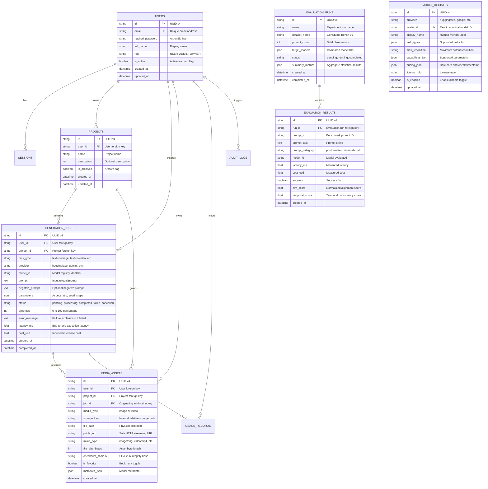

# Database Design Document
## GenStudio AI: Relational Schema Specification & Entity-Relationship Model

### 1. Database Architecture Overview
The persistence layer utilizes SQLAlchemy 2.0 with strict relational integrity constraints:
- **Primary Keys:** UUID v4 strings (36 characters) ensuring distributed uniqueness without sequence bottlenecks.
- **Foreign Keys:** Cascading deletes (`CASCADE`) on parent-child relationships (e.g., User -> Projects) and nullification (`SET NULL`) on asset references.
- **Timestamps:** UTC timestamps (`created_at`, `updated_at`) indexed for chronological pagination.
- **Indexing:** High-cardinality foreign keys (`user_id`, `project_id`, `job_id`) and status fields are indexed.

### 2. Entity-Relationship Diagram (Mermaid)

