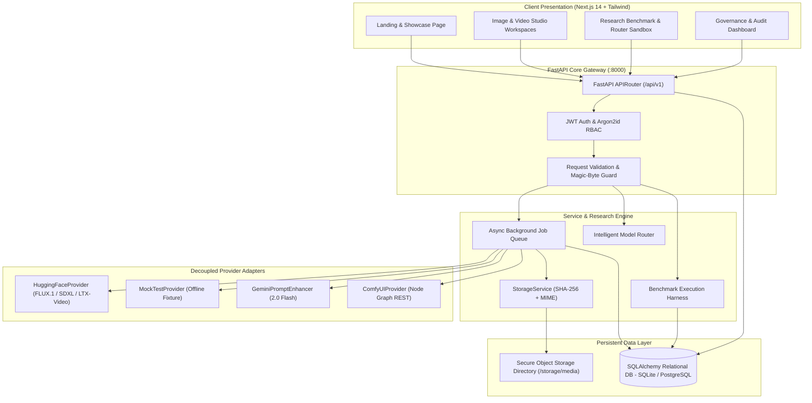
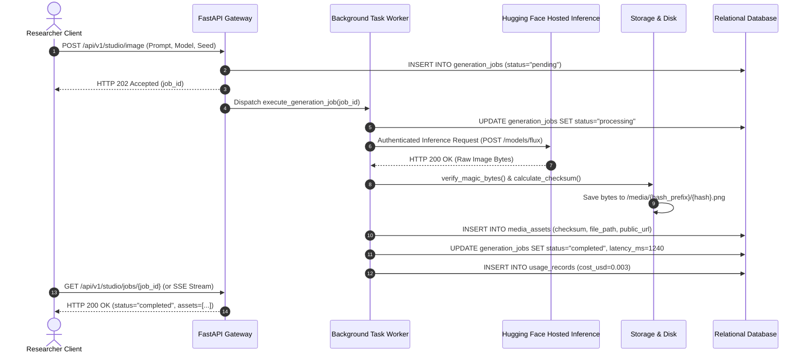

# System Architecture
## GenStudio AI: Architectural Blueprint & Distributed Design

### 1. High-Level Architecture Overview
GenStudio AI employs a decoupled, asynchronous micro-tier architecture comprising:
1. **Presentation Layer:** Next.js 14 App Router, React 18, TypeScript, Tailwind CSS, Lucide icons.
2. **API & Orchestration Layer:** FastAPI application running on Uvicorn with Pydantic validation, Argon2id security, and async background workers.
3. **Provider Integration Abstraction:** Unified adapter interfaces for Hugging Face Inference Providers, Google Gemini 2.0 Flash, ComfyUI, and offline test fixtures.
4. **Research Engine:** Multi-objective utility router, standardized benchmark dataset, and metrics calculator.
5. **Data & Storage Persistence:** Relational database (SQLite local zero-dependency / PostgreSQL production) managed via SQLAlchemy 2.0 and Alembic migrations, coupled with SHA256-verified local object storage.

### 2. Architecture Diagram (Mermaid)

### 3. Asynchronous Job Lifecycle Sequence (Mermaid)

